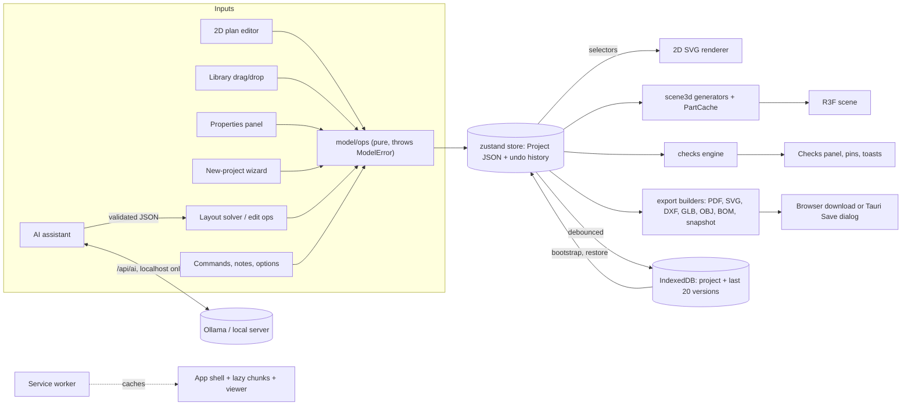

# Architecture

## Stack
Vite + React 18 + TypeScript (strict, `noUncheckedIndexedAccess`). 3D: `three` + `@react-three/fiber` + `drei`.
State: `zustand` + `immer`, undo/redo via `zundo` (wired in prompt 2). Validation: `zod`. Styling: Tailwind CSS 3 + `lucide-react`.
Persistence: `idb-keyval` (IndexedDB). Tests: Vitest + Testing Library (unit), Playwright (e2e smoke, runs against `vite preview` on :4173).
Path alias `@/` → `src/`.

## Single source of truth
The **project JSON** (data model, prompt 2) is the only design state. The 2D plan, 3D scene, exports and AI features
read from it or write to it through store actions (all undoable). The 3D scene never holds design state of its own.
Ephemeral UI state (view mode, active tab, drawers) lives in `src/ui/uiStore.ts` and is never saved in the project.

## Units
Lengths are stored in **meters**, angles in **radians**. Conversion to metric/feet-inches happens only in the UI layer.

## Module map (final)
| Folder | Purpose |
|---|---|
| `src/app` | Shell: `App`, `TopBar`, sidebars, panels, dialogs, `ErrorBoundary`, `HistoryPanel` |
| `src/model` | Zod schemas/types, `store` (zustand + immer + zundo), `ops/*` (every edit), migration, sample project |
| `src/geometry` | Pure 2D math: polygons, wall joins, room detection (`rooms.ts`), snapping |
| `src/plan2d` | SVG plan editor: interaction state machine, hit-testing, symbols |
| `src/scene3d` | Pure generators → `SceneBuilder` (cached parts) → R3F scene; `camera/` (orbit, walk, top, sections, isolation, measure, minimap); `clipping.ts` |
| `src/catalog` | 49 procedural items with 2D/3D builders, placement rules, library panel |
| `src/materials` | Material library, procedural textures, picker helpers |
| `src/ai` | Provider abstraction, schemas, pipeline (validate + repair + fallback), layout solver, offline generator, edit ops |
| `src/checks` | Constraint rules (stairs, reachability, windows, drains, areas, door swings), area schedule |
| `src/wizard`, `src/templates` | New-project wizard and the four starter templates |
| `src/export` | PDF/SVG/DXF/GLB/OBJ/PNG/BOM/snapshot builders and the export dialog |
| `src/viewer` | Second Vite entry: the read-only snapshot viewer (built to `public/viewer/`) |
| `src/notes`, `src/options` | Pinned notes; design options and comparison |
| `src/commands`, `src/onboarding` | Command palette, shortcut sheet; first-run tour |
| `src/prefs`, `src/i18n`, `src/theme.css` | Language/theme/motion preferences; English + Bengali; colour tokens |
| `src/persistence` | IndexedDB repo, autosave, 20-version history, bootstrap |
| `src/pwa`, `src/platform` | Service worker registration/install prompt; browser-vs-Tauri file adapter |
| `src/perf` | Stress project and performance budgets (tests) |
| `src/ui` | `Modal`, `Drawer`, `PopoverMenu`, units, `uiStore` |
| `server/` | `/api/ai` proxy to the user's local model (dev and preview servers) |
| `src-tauri/` | Optional desktop shell |

## Data flow

Rules that keep this tidy: only `model/ops` mutate the project; the AI never writes geometry (the solver does); the
3D scene and exports only read; transient state (camera, tool, dialogs) lives outside the project and is never undone.

## Layout
Top bar (name, undo/redo, 2D/3D/Split, export) · left sidebar (Library/Levels/AI tabs) · center viewport(s) ·
right Properties panel · bottom status bar. Below the `lg` breakpoint sidebars become drawers (`ui/Drawer`).

## Adding modules
New features add a folder-scoped module that reads the project via selectors and mutates via store actions; add i18n
keys to `en.ts`; add unit tests for pure logic; extend `e2e/` for UI flows.

## Data model & store (prompt 2)
- `model/schemas.ts` (Zod) is the source of truth for types (`model/types.ts` infers them). `SCHEMA_VERSION` = 1; `migrate.ts` upgrades by `schemaVersion` then validates.
- Coordinates: plan `(x, y)` → world `(x, elevation, y)`. Level `elevation` = top of that level's floor, derived by `recomputeLevels` (below.elevation + below.floorToCeiling + this.slab).
- Stair: `position` = bottom-center of first step, `rotation` = ascent direction (0 = +x, π/2 = +y).
- `model/integrity.ts`: pure rules (min wall length, opening fit/overlap, items inside shell footprint).
- `model/ops/*`: pure functions mutating an immer draft `Project`; they throw `ModelError` on rule violations.
- `model/store.ts`: `useModel` (project, selection, activeLevelId, tool, viewMode) with immer + zundo (history = `project` only).
  `apply(fn)` / `edit(fn)` runs ALL ops in `fn` as one undoable step (this is the batch/transaction mechanism; a throw discards the whole edit).
  `loadProject` replaces the project and clears history. `undo()/redo()` also repair active level/selection.
- `persistence/`: `storage` (IndexedDB via idb-keyval, memory backend in tests), `repo` (list/save/rename/duplicate/delete), `autosave` (1 s debounce), `bootstrap` (reopen last project).
- `model/io.ts`: JSON import/export (validated). `model/sample.ts`: sample duplex in a 10 × 12 m shell.
- UI: `app/LevelsPanel`, `app/ProjectsDialog`, `app/useShortcuts` (Ctrl/Cmd+Z, +Shift+Z, Ctrl+Y). `ui/uiStore` keeps only ephemeral UI state.

## 2D plan editor (prompt 3)
- `geometry/walls.ts` `computeWallPolygons(walls, {join, miterLimit})`: wall outlines with mitred (or butt) joins at shared endpoints. Reused by 3D.
- `geometry/rooms.ts`: `detectRoomPolygons(segments)` splits centerlines at crossings/T-junctions and traces minimal faces; `matchRooms` pairs detected faces with existing rooms by overlap (IoU) so names/types survive edits. Room areas are measured on wall **centerlines**; islands (a closed loop fully inside another room) do not cut a hole in the outer room.
- `geometry/snap.ts`: endpoint → midpoint → angle (0/45/90 + parallel/perpendicular to walls) → grid snapping.
- `model/ops/plan.ts`: `syncRooms`, `addWallChain`, `addRoomWithWalls`, `setWallGeometry`, `deleteWallsAndSync`, `deleteRoomWithWalls`. Rooms are derived from walls: every wall edit re-runs `syncRooms` for the level inside the same undoable `apply`.
- `plan2d/`: `view.ts` (pan/zoom/fit/grid maths), `hit.ts` (hit testing, box select), `moves.ts` (wall/endpoint/room moves with connected walls following), `draftStore.ts` (transient drawing/drag state), `interaction.ts` (pointer + keyboard handlers, tools: V select, W wall, R room (rect/poly), M measure, Del), `planStore.ts` (view, cursor, and view prefs: snap on/off, grid size, ghost levels, all dimensions — saved in localStorage, not in the project), `layers.tsx`, `PlanCanvas.tsx`, `PlanToolbar.tsx`.
- While dragging, walls are previewed from draft state and committed in ONE `apply` on pointer-up; a wall chain is committed as one undo step on finish.
- `app/PropertiesPanel.tsx`: wall/room fields incl. multi-selection ("Mixed"); `ui/units.ts`: format/parse lengths and areas (metric or ft/in). Project `settings` now only holds `defaultWallThickness`.

## 3D generation (prompt 4)
- Geometry is generated per entity by pure functions in `scene3d/generators/*` (model → `Part`s = `BufferGeometry` + material keys + the entity a click selects). Parts are in **level-local** coordinates: plan `(x, y)` → `(x, height above the level's floor, y)`; the scene places each level group at `level.elevation`.
- Walls: wall elevation `Shape` (+ holes; doors are notches in the outline, no CSG) extruded by thickness, ends slid to the shared mitre from `computeWallPolygons`. Material groups: `[leftFace, rightFace, edges]`; for exterior walls the left/right faces are mapped to inside/outside by testing against the shell footprint.
- `generators/voids.ts`: slab openings = stair voids (only where headroom < 2 m, from `layoutStair`), `void` roofs, and doubleHeight rooms on the level below. Boolean work on plan polygons uses `polygon-clipping` (`subtractPolygons`).
- `generators/stairs.ts`: `layoutStair` (riser ≈ 0.18 m from level elevation difference, tread ≥ 0.25 m, straight/L/U/spiral, railings), `validateStair` (fits shell? headroom? comfort? skipped level?) — warnings are shown on the 3D canvas.
- `scene3d/cache.ts` `PartCache` + `sceneModel.ts` `SceneBuilder`: per-entity memoization keyed on entity identity (+ dependencies); stale geometries are disposed. `ModelScene` renders levels; `sceneStore` holds view prefs (levels shown, walls up/cut/transparent, dollhouse, doors ajar). Cut mode rebuilds walls at 1.2 m and clips trim with a plane; dollhouse hides ceilings and flat roofs.
- Clicking a mesh calls `selectFrom3d` → shared selection in `useModel` (and switches the active level), so 2D and Properties follow; selected parts are tinted and edge-outlined.
- `materials/index.ts` resolves material keys to render specs (full library comes in a later prompt).

## Component library (prompt 5)
- `catalog/` is a typed registry (`CATALOG`, `getEntry`, `entriesByCategory`, `openingStyles`). Each `CatalogEntry`: `catalogId`, `nameKey` (i18n), `category`, `placement` (`wall` | `floor` | `wall-mounted` | `ceiling`), `defaultSize {w,d,h}`, `props` (schema of adjustable properties) + `defaults`, `build3D(props, size, ctx)` (procedural three.js `Group`, origin bottom-centre, front = +z) and `draw2D(props, size, ctx)` (SVG symbol in metres). 49 entries in `entries/openings.tsx`, `furniture.tsx`, `kitchenBath.tsx` — all built from primitives, no assets.
- Doors/windows are `Opening`s (new `props` field for style options such as frame colour; `catalogId` is the style). Everything else is an `Item` whose size is `defaultSize × scale` (x = width, y = height, z = depth) and whose `props` hold colours/variants. Unknown ids fall back to the default style for the opening kind.
- Doors and windows in 3D are catalog models positioned on the wall (`generators/openings.ts`); furniture is `generators/items.ts`. Both produce `ObjectPart`s (a positioned `Object3D`) next to the baked-geometry `Part`s; selection tint / clipping create shared material variants (`scene3d/objectView.ts`).
- `catalog/placement.ts` (pure, tested): `placeOnWall` (nearest wall, fit/height/overlap checks, nudges next to neighbours up to one width, dimensions to both corners), `placeItem` (15° rotation snap, back-to-wall snapping with the front facing into the room, wall-mounted must be on a wall, ceiling items hang from the ceiling, must stay inside the shell, non-blocking clearance warnings vs other items / columns / walls). `catalog/actions.ts` applies results to the store (`placeCatalogEntry`, `moveItemTo`, `slideOpening`, rotate/nudge/duplicate/delete) as single undo steps; messages go through `i18n.tf`.
- Library UI (`catalog/LibraryPanel.tsx`): category tabs + search; cards drag with HTML5 DnD (`dragStore.dragId`) or tap to “arm” (`armedId`) then tap/click the destination (touch friendly). Thumbnails are rendered once from `build3D` by one shared WebGL renderer (`thumbnails.ts`) and cached; no-WebGL falls back to a letter tile.
- 2D (`plan2d/interaction.ts`, `symbols.tsx`, `hit.ts`): items/openings drawn with `draw2D`, hit-tested before walls, dragged with live ghost + messages, rotate handle (15° steps), ghost with distance-to-corner dimensions while carrying a door/window. 3D (`scene3d/DropTarget.tsx`, `pick.ts`): drop/click raycasts to the active level's floor (wall surface for doors/windows); drei `TransformControls` move/rotate gizmo on a single selected item (`sceneStore.gizmoMode`).
- App-wide keys (`app/useManipulationShortcuts.ts`): R rotate 90° (Shift+R back), Ctrl/Cmd+D duplicate, arrows nudge 5 cm (Shift 25 cm; slides doors along walls), Delete, Esc cancels a carried item. Properties for items/openings: `app/CatalogProps.tsx`.
- `window.__duplex.getProject()` is a read-only debug hook used by e2e tests.

## Materials, textures & lighting (prompt 6)
- `materials/library.ts`: `MATERIALS` (id, `nameKey`, categories floor/wall/ceiling/surface, colour, procedural `texture` kind, `textureScale` = metres covered by one repeat, roughness/metalness). Custom paint is any id of the form `paint:#rrggbb`. Generator keys (`slab`, `frame`, …) are internal ids. `resolveDef/resolveMaterial` map any id (incl. unknown → flat grey) to a render spec; `project.materials` overrides still apply.
- `materials/textures.ts`: canvas-painted, seamless, seeded textures (wood planks light/dark, herringbone-style parquet, square/subway/large tiles, marble, concrete, carpet, brick, slats, wallpaper stripes/damask/dots, laminate, brushed metal), cached; `repeat = 1 / textureScale`. No canvas (tests) → flat colour.
- **Real-world UVs**: generators emit UVs in metres (ShapeGeometry/ExtrudeGeometry coordinates for floors, ceilings, slabs and wall faces; `boxProjectUV` for furniture), so a tile is the same size on every wall/room (tested).
- Picking: `app/MaterialPicker.tsx` swatch grid in Properties for wall inside/outside faces, room floor/ceiling and a furniture item's main surface (`props.material`, swaps the item's main colour for a textured library material). Shortcuts: `paintRoomWalls` (room-facing face of every wall around the room), `paintLevelWalls/Floors/Ceilings`. Left/right of a wall maps to inside/outside via `insideSign` (`model/integrity`).
- Eyedropper tool (`I`, 2D and 3D toolbars): first click copies a surface's material (`materials/eyedropper.ts`, `Surface` = wall face | floor | ceiling | item), further clicks paint it; Alt+click copies again; each paint is one undo step.
- Lighting (`scene3d/lighting.ts`, pure + tested): `sunAt(time, compass)` (east 06:00 → south 13:00 → west 20:00, warm when low), `moonAt`, `skyFor`, presets Morning/Noon/Evening/Night (`interiorLightsOn` for evening/night). Compass is `project.settings.compass` (undoable); time/preset/quality/FPS are view prefs in `sceneStore`. `scene3d/SceneLights.tsx`: sun with shadows, hemisphere sky light, local `RoomEnvironment` PMREM (no network), vertex-gradient sky dome, point lights for lamp items (`CatalogEntry.lamp`, emissive lamp meshes marked `userData.lamp`) limited by quality.
- Quality (`scene3d/quality.ts`): Low (no shadows/AA/AO, 4 lamps), Medium (1024 shadows, env, 8 lamps), High (2048 shadows, SSAO via lazy `AmbientOcclusion` chunk, 12 lamps, 2 shadow lamps); `Auto` uses `detectQuality` (GPU string, cores, memory, touch). Changing quality remounts the canvas (AA is fixed at context creation). Optional FPS readout in the Light & quality popover.

## AI assistant (prompt 7)
- **Never raw geometry.** The model only produces a `DesignIntent` (levels → rooms with type, name, target area, min width, adjacency `door|open`, exterior-wall preference, plumbing, `above`) or an `EditResponse` (list of `EditOperation`s). Both are Zod schemas in `ai/schemas.ts`; `jsonSchemaOf` uses Zod 4's built-in `z.toJSONSchema` (so `zod-to-json-schema` is not needed) and is passed to Ollama as `format` / OpenAI `response_format`.
- **Providers** (`ai/provider.ts`): `LLMProvider.generate(req) → text`. Ollama (default `qwen3:14b`, `/api/chat`, `stream:false`, `think:false`, temperature 0.2, `num_ctx` 8192) and OpenAI-compatible (LM Studio / llama.cpp) both go through the app's own `POST /api/ai`; the browser never contacts Ollama. `server/aiProxy.ts` (Node handler, reused by prompt 13's server) takes an envelope `{target, baseUrl?, path, method?, body?}`, allow-lists `/api/chat` `/api/tags` (Ollama) and `/chat/completions` `/models` (OpenAI-compatible, private hosts only), limits bodies to 1 MB, 180 s timeout, and queues generations one at a time. A small Vite plugin mounts it on dev and preview servers. Settings (provider, model, base URL) are in `ai/provider.ts` (`useAiSettings`, localStorage) with a "Test connection" that lists installed models.
- **Pipeline** (`ai/pipeline.ts`): compact prompt (`ai/prompts.ts`: rules + 2 examples + project summary from `ai/summary.ts`, never the project JSON) → model → strip fences/`<think>` → Zod validate → on failure ONE repair round-trip with the errors → otherwise fall back. `ProviderUnreachable`/`ProviderError`/`AiOutputError` all end in the offline generator (or the rule-based edit reader) with a plain-language note; abort is propagated, never turned into a fallback. Unvalidated output never reaches the project.
- **Offline generator** (`ai/offline.ts`): keyword rules (counts, number words, "for N people", open-plan, study, utility, balcony, en-suite, style words, stair type) → `DesignIntent`; deterministic variations. `ai/offlineEdit.ts`: regexes for the common edit commands.
- **Layout solver** (`ai/layout/`, deterministic, seeded): `solveLayout(intent + shell facts) → LayoutPlan`. Largest inner rectangle of the shell; stair hall placed in a corner near the entrance (same rectangle on every level, stair centred in it, void comes from the stair); remainder split into ≤ 2 rectangles; rooms ordered by an adjacency chain (plus seeded shuffles) and tiled by a squarified treemap; candidates scored for min widths, aspect, unmet adjacency, windows/exterior walls, wet rooms near plumbing, stacked bathrooms, reachability; best wins. Areas are scaled/capped per room type; partitions snap onto structural columns when it keeps rooms wide enough. Then merged wall segments, doors (requested + a reachability tree that keeps bedrooms private), archways for open-plan links, entrance door, windows, default furniture (`furnish.ts`, collision/door-swing aware) and plain-language warnings for anything unmet. `applyPlan` writes it into the project inside ONE store `apply` (keeps shell + columns, repeats columns per level) and re-detects/names rooms.
- **Edits** (`ai/edit/`): `lookup.ts` (fuzzy room/level/material/catalog resolution), `walls.ts` (`moveWallLine`: pushes a whole straight wall; walls ending on it follow so rooms stay closed; refuses outer walls, tiny rooms, doors that no longer fit), `apply.ts` (`applyEditOps` — resize/move/add/remove/rename/material/items/openings/stair), `diff.ts` (`describeChanges` → "Living room 42.0 → 49.0 m²", "Move the wall between … by 1.0 m"). The UI previews on a copy (`produce`) and applies via one `store.apply` = one undo step; any error aborts everything.
- **UI** (`ai/AiPanel.tsx`, `aiStore.ts`, `AiSettingsPanel.tsx`, `PlanThumb.tsx`): provider/model status, Design | Edit modes, example chips, "Add furniture", Generate / "Generate 3 variations" (sequential, each result appears when ready; a dead model is not retried for the remaining variations), elapsed time + Cancel, option cards with level thumbnails, notes and Apply / Discard; edit preview with Apply / Discard.

## Duplex features (prompt 8)
- `src/wizard/shell.ts` (pure): `footprintOf`, `validateFootprint`, `planHeights`, `projectFromConfig`, `addFacadeWindows` (locked openings from `shell.windows`); `ShellWizard.tsx` is the 4-step UI opened from "New project" (`uiStore.wizardOpen`); `finish.ts` lays a template into the shell.
- `src/templates/`: four `DesignIntent`s solved by `solveLayout` (so they adapt to any shell).
- `src/checks/`: pure `runChecks(project)` → `CheckIssue[]`; `areaSchedule`; `focusIssue` selects, switches level/view and flashes the target; `isVoidRoom` excludes "Open to below" pseudo-rooms from all rules and areas.
- Model additions: `shell.beams`, `shell.windows`, `Opening.locked` (geometry edits and delete throw `ModelError`), `settings.checks`.
- Double height: `Room.doubleHeight` → `doubleHeightVoids` (slab opening above) + `generateVoidBalustrade`; `copyWallsFromBelow` op; stairs have a 2D symbol on both levels.

## Camera & inspection (prompt 9)
- `scene3d/camera/cameraStore.ts` (transient zustand, never in the project): mode, fly request, live pose, walker, section, isolation, x-ray, measurements. Only `project.views` (saved views, with thumbnail and section) is persisted.
- Pure modules: `views.ts` (presets, top pose, easing), `walk.ts` (walk world from walls/columns/stairs/voids; `moveWalker`, `floorAt`, `spawnWalker`), `section.ts` (planes and analytic caps), `focus.ts`, `isolation.ts`, `measure.ts`, `minimapFrame.ts`.
- React/three: `CameraSystem` (orbit/top rigs, transitions, capture), `WalkRig`, `SectionRig` (caps + drag handle), `MeasureOverlay`, DOM overlays `CameraToolbar`, `SavedViewsStrip`, `Minimap`, `WalkHud`.
- `scene3d/clipping.ts`: every model material registers itself; `setSectionPlanes` updates their `clippingPlanes` (the sky/grid stay unclipped).
- The scene hides nothing in walk mode (all levels, walls up); isolation/x-ray decide per-part ghosting in `ModelScene`.
- `window.__duplex.getCamera()` is a read-only test hook like `getProject()`.

## Export & sharing (prompt 10)
- `src/export/`: pure builders — `planSvg.tsx` (static per-level SVG in plan metres, paper-sized strokes; reuses the editor's symbols via `renderToStaticMarkup`), `pdf.ts` (jsPDF; `Placement` records every drawing's size in mm), `dxf.ts`, `model3d.ts` (GLB via GLTFExporter, OBJ/MTL writer), `bom.ts` (quantities, pricing, CSV), `snapshot.ts` (self-contained HTML).
- `bridge.tsx` registers a capture function from inside the Canvas; `scene.ts` opens the 3D view if needed (`withScene`) and takes the hero picture; `flags.ts` switches presentation/transparent looks.
- `ExportDialog.tsx` (tabs: Images, PDF plans, 3D model, Plan files, Costs, Share). Unit costs live in `project.costs` and change through `setUnitCost`/`setCurrency` ops (undoable, saved with the project).
- Snapshot viewer: `src/viewer/` is a second Vite entry (`vite.viewer.config.ts`, IIFE + CSS) built into `public/viewer/`; `fetchViewerBundle()` loads it at export time and `buildSnapshotHtml` inlines it with the project JSON.

## Polish & accessibility (prompt 11)
- `src/prefs/prefsStore.ts`: language/theme/motion/tourSeen (localStorage) applied to `<html>` (`lang`, `data-theme`, `data-motion`). Colours are CSS variables in `src/theme.css`, mapped into Tailwind in `tailwind.config.js`.
- `src/ui/Modal.tsx` is the one accessible dialog (used by every dialog and the drawers/bottom sheets); `modalOpen()` makes global shortcuts stand down.
- `src/commands/`: command registry + palette, shortcut sheet data, key formatting. `src/onboarding/`: tour.
- `src/notes/` and `src/options/`: pinned notes; design options (`project.options` + `currentOption`, ops in `model/ops/options.ts`; the compare dialog renders projects through `SceneProjectProvider`).
- i18n: `bn.ts` must contain every `en.ts` key; `ModelError` carries a translation key so `e.message` follows the language; `fmtNum` formats numbers per locale.
