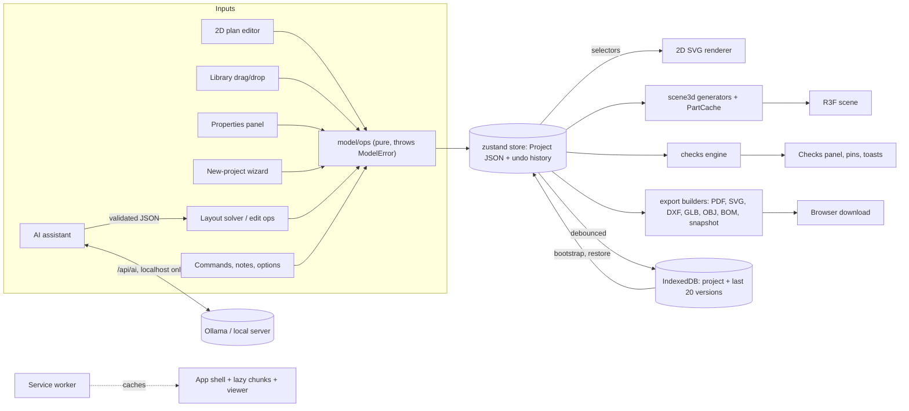

# Architecture

## Stack

Vite + React 18 + TypeScript (strict, `noUncheckedIndexedAccess`). 3D: `three` + `@react-three/fiber` + `drei`.
State: `zustand` + `immer`, undo/redo via `zundo` (wired in prompt 2). Validation: `zod`. Styling: Tailwind CSS 3 + `lucide-react`.
Persistence: `idb-keyval` (IndexedDB). Tests: Vitest + Testing Library (unit), Playwright (e2e smoke, runs against `vite preview` on :4173).
Path alias `@/` → `src/`.

## Single source of truth

The **project JSON** (data model, prompt 2) is the only design state. The 2D plan, 3D scene, exports and AI features
read from it or write to it through store actions (all undoable). The 3D scene never holds design state of its own.
Ephemeral UI state (view mode, active tab, drawers) lives in `src/ui/uiStore.ts` and is never saved in the project.

## Units

Lengths are stored in **meters**, angles in **radians**. Conversion to metric/feet-inches happens only in the UI layer.

## Module map (final)

| Folder                                   | Purpose                                                                                                                                         |
| ---------------------------------------- | ----------------------------------------------------------------------------------------------------------------------------------------------- |
| `src/app`                                | Shell: `App`, `TopBar`, sidebars, panels, dialogs, `ErrorBoundary`, `HistoryPanel`                                                              |
| `src/model`                              | Zod schemas/types, `store` (zustand + immer + zundo), `ops/*` (every edit), migration, sample project                                           |
| `src/geometry`                           | Pure 2D math: polygons, wall joins, room detection (`rooms.ts`), snapping                                                                       |
| `src/plan2d`                             | SVG plan editor: interaction state machine, hit-testing, symbols                                                                                |
| `src/scene3d`                            | Pure generators → `SceneBuilder` (cached parts) → R3F scene; `camera/` (orbit, walk, top, sections, isolation, measure, minimap); `clipping.ts` |
| `src/catalog`                            | 49 procedural items with 2D/3D builders, placement rules, library panel                                                                         |
| `src/materials`                          | Material library, procedural textures, picker helpers                                                                                           |
| `src/ai`                                 | Provider abstraction, schemas, pipeline (validate + repair + fallback), layout solver, offline generator, edit ops                              |
| `src/checks`                             | Constraint rules (stairs, reachability, windows, drains, areas, door swings), area schedule                                                     |
| `src/wizard`, `src/templates`            | New-project wizard and the four starter templates                                                                                               |
| `src/export`                             | PDF/SVG/DXF/GLB/OBJ/PNG/BOM/snapshot builders and the export dialog                                                                             |
| `src/viewer`                             | Second Vite entry: the read-only snapshot viewer (built to `public/viewer/`)                                                                    |
| `src/notes`, `src/options`               | Pinned notes; design options and comparison                                                                                                     |
| `src/reference`                          | Reference spec (Zod), the exact builder, project → spec export, fidelity report, walkthrough check                                              |
| `src/underlay`                           | Reference pictures: rectification maths glue, 2D layer, 3D decal, setup dialog, panel, "Compare with reference" view                            |
| `src/ai/vision`                          | "Recreate from picture": label / region extraction with a local vision model, geometry clean-up, review screen, spec builder                    |
| `src/custom`                             | The user's own `.glb` models and textures (app-server assets, `/api/assets`)                                                                    |
| `src/commands`, `src/onboarding`         | Command palette, shortcut sheet; first-run tour                                                                                                 |
| `src/prefs`, `src/i18n`, `src/theme.css` | Language/theme/motion preferences; English + Bengali; colour tokens                                                                             |
| `src/persistence`                        | IndexedDB repo, autosave, 20-version history, bootstrap                                                                                         |
| `src/pwa`, `src/platform`                | Service worker registration/install prompt; browser file-download adapter                                                                       |
| `src/perf`                               | Stress project and performance budgets (tests)                                                                                                  |
| `src/ui`                                 | `Modal`, `Drawer`, `PopoverMenu`, units, `uiStore`                                                                                              |
| `server/`                                | `/api/ai` proxy to the user's local model (dev and preview servers)                                                                             |

## Data flow

Rules that keep this tidy: only `model/ops` mutate the project; the AI never writes geometry (the solver does); the
3D scene and exports only read; transient state (camera, tool, dialogs) lives outside the project and is never undone.

## Layout

Top bar (name, undo/redo, 2D/3D/Split, export) · left sidebar (Library/Levels/AI tabs) · center viewport(s) ·
right Properties panel · bottom status bar. Below the `lg` breakpoint sidebars become drawers (`ui/Drawer`).

## Adding modules

New features add a folder-scoped module that reads the project via selectors and mutates via store actions; add i18n
keys to `en.ts`; add unit tests for pure logic; extend `e2e/` for UI flows.

## Data model & store (prompt 2)

- `model/schemas.ts` (Zod) is the source of truth for types (`model/types.ts` infers them). `SCHEMA_VERSION` = 1; `migrate.ts` upgrades by `schemaVersion` then validates.
- Coordinates: plan `(x, y)` → world `(x, elevation, y)`. Level `elevation` = top of that level's floor, derived by `recomputeLevels` (below.elevation + below.floorToCeiling + this.slab).
- Stair: `position` = bottom-center of first step, `rotation` = ascent direction (0 = +x, π/2 = +y).
- `model/integrity.ts`: pure rules (min wall length, opening fit/overlap, items inside shell footprint).
- `model/ops/*`: pure functions mutating an immer draft `Project`; they throw `ModelError` on rule violations.
- `model/store.ts`: `useModel` (project, selection, activeLevelId, tool, viewMode) with immer + zundo (history = `project` only).
  `apply(fn)` / `edit(fn)` runs ALL ops in `fn` as one undoable step (this is the batch/transaction mechanism; a throw discards the whole edit).
  `loadProject` replaces the project and clears history. `undo()/redo()` also repair active level/selection.
- `persistence/`: `storage` (IndexedDB via idb-keyval, memory backend in tests), `repo` (list/save/rename/duplicate/delete), `autosave` (1 s debounce), `bootstrap` (reopen last project).
- `model/io.ts`: JSON import/export (validated). `model/sample.ts`: sample duplex in a 10 × 12 m shell.
- UI: `app/LevelsPanel`, `app/ProjectsDialog`, `app/useShortcuts` (Ctrl/Cmd+Z, +Shift+Z, Ctrl+Y). `ui/uiStore` keeps only ephemeral UI state.

## 2D plan editor (prompt 3)

- `geometry/walls.ts` `computeWallPolygons(walls, {join, miterLimit})`: wall outlines with mitred (or butt) joins at shared endpoints. Reused by 3D.
- `geometry/rooms.ts`: `detectRoomPolygons(segments)` splits centerlines at crossings/T-junctions and traces minimal faces; `matchRooms` pairs detected faces with existing rooms by overlap (IoU) so names/types survive edits. Room areas are measured on wall **centerlines**; islands (a closed loop fully inside another room) do not cut a hole in the outer room.
- `geometry/snap.ts`: endpoint → midpoint → angle (0/45/90 + parallel/perpendicular to walls) → grid snapping.
- `model/ops/plan.ts`: `syncRooms`, `addWallChain`, `addRoomWithWalls`, `setWallGeometry`, `deleteWallsAndSync`, `deleteRoomWithWalls`. Rooms are derived from walls: every wall edit re-runs `syncRooms` for the level inside the same undoable `apply`.
- `plan2d/`: `view.ts` (pan/zoom/fit/grid maths), `hit.ts` (hit testing, box select), `moves.ts` (wall/endpoint/room moves with connected walls following), `draftStore.ts` (transient drawing/drag state), `interaction.ts` (pointer + keyboard handlers, tools: V select, W wall, R room (rect/poly), M measure, Del), `planStore.ts` (view, cursor, and view prefs: snap on/off, grid size, ghost levels, all dimensions — saved in localStorage, not in the project), `layers.tsx`, `PlanCanvas.tsx`, `PlanToolbar.tsx`.
- While dragging, walls are previewed from draft state and committed in ONE `apply` on pointer-up; a wall chain is committed as one undo step on finish.
- `app/PropertiesPanel.tsx`: wall/room fields incl. multi-selection ("Mixed"); `ui/units.ts`: format/parse lengths and areas (metric or ft/in). Project `settings` now only holds `defaultWallThickness`.

## 3D generation (prompt 4)

- Geometry is generated per entity by pure functions in `scene3d/generators/*` (model → `Part`s = `BufferGeometry` + material keys + the entity a click selects). Parts are in **level-local** coordinates: plan `(x, y)` → `(x, height above the level's floor, y)`; the scene places each level group at `level.elevation`.
- Walls: wall elevation `Shape` (+ holes; doors are notches in the outline, no CSG) extruded by thickness, ends slid to the shared mitre from `computeWallPolygons`. Material groups: `[leftFace, rightFace, edges]`; for exterior walls the left/right faces are mapped to inside/outside by testing against the shell footprint.
- `generators/voids.ts`: slab openings = stair voids (only where headroom < 2 m, from `layoutStair`), `void` roofs, and doubleHeight rooms on the level below. Boolean work on plan polygons uses `polygon-clipping` (`subtractPolygons`).
- `generators/stairs.ts`: `layoutStair` (riser ≈ 0.18 m from level elevation difference, tread ≥ 0.25 m, straight/L/U/spiral, railings), `validateStair` (fits shell? headroom? comfort? skipped level?) — warnings are shown on the 3D canvas.
- `scene3d/cache.ts` `PartCache` + `sceneModel.ts` `SceneBuilder`: per-entity memoization keyed on entity identity (+ dependencies); stale geometries are disposed. `ModelScene` renders levels; `sceneStore` holds view prefs (levels shown, walls up/cut/transparent, dollhouse, doors ajar). Cut mode rebuilds walls at 1.2 m and clips trim with a plane; dollhouse hides ceilings and flat roofs.
- Clicking a mesh calls `selectFrom3d` → shared selection in `useModel` (and switches the active level), so 2D and Properties follow; selected parts are tinted and edge-outlined.
- `materials/index.ts` resolves material keys to render specs (full library comes in a later prompt).

## Component library (prompt 5)

- `catalog/` is a typed registry (`CATALOG`, `getEntry`, `entriesByCategory`, `openingStyles`). Each `CatalogEntry`: `catalogId`, `nameKey` (i18n), `category`, `placement` (`wall` | `floor` | `wall-mounted` | `ceiling`), `defaultSize {w,d,h}`, `props` (schema of adjustable properties) + `defaults`, `build3D(props, size, ctx)` (procedural three.js `Group`, origin bottom-centre, front = +z) and `draw2D(props, size, ctx)` (SVG symbol in metres). 49 entries in `entries/openings.tsx`, `furniture.tsx`, `kitchenBath.tsx` — all built from primitives, no assets.
- Doors/windows are `Opening`s (new `props` field for style options such as frame colour; `catalogId` is the style). Everything else is an `Item` whose size is `defaultSize × scale` (x = width, y = height, z = depth) and whose `props` hold colours/variants. Unknown ids fall back to the default style for the opening kind.
- Doors and windows in 3D are catalog models positioned on the wall (`generators/openings.ts`); furniture is `generators/items.ts`. Both produce `ObjectPart`s (a positioned `Object3D`) next to the baked-geometry `Part`s; selection tint / clipping create shared material variants (`scene3d/objectView.ts`).
- `catalog/placement.ts` (pure, tested): `placeOnWall` (nearest wall, fit/height/overlap checks, nudges next to neighbours up to one width, dimensions to both corners), `placeItem` (15° rotation snap, back-to-wall snapping with the front facing into the room, wall-mounted must be on a wall, ceiling items hang from the ceiling, must stay inside the shell, non-blocking clearance warnings vs other items / columns / walls). `catalog/actions.ts` applies results to the store (`placeCatalogEntry`, `moveItemTo`, `slideOpening`, rotate/nudge/duplicate/delete) as single undo steps; messages go through `i18n.tf`.
- Library UI (`catalog/LibraryPanel.tsx`): category tabs + search; cards drag with HTML5 DnD (`dragStore.dragId`) or tap to “arm” (`armedId`) then tap/click the destination (touch friendly). Thumbnails are rendered once from `build3D` by one shared WebGL renderer (`thumbnails.ts`) and cached; no-WebGL falls back to a letter tile.
- 2D (`plan2d/interaction.ts`, `symbols.tsx`, `hit.ts`): items/openings drawn with `draw2D`, hit-tested before walls, dragged with live ghost + messages, rotate handle (15° steps), ghost with distance-to-corner dimensions while carrying a door/window. 3D (`scene3d/DropTarget.tsx`, `pick.ts`): drop/click raycasts to the active level's floor (wall surface for doors/windows); drei `TransformControls` move/rotate gizmo on a single selected item (`sceneStore.gizmoMode`).
- App-wide keys (`app/useManipulationShortcuts.ts`): R rotate 90° (Shift+R back), Ctrl/Cmd+D duplicate, arrows nudge 5 cm (Shift 25 cm; slides doors along walls), Delete, Esc cancels a carried item. Properties for items/openings: `app/CatalogProps.tsx`.
- `window.__duplex.getProject()` is a read-only debug hook used by e2e tests.

## Materials, textures & lighting (prompt 6)

- `materials/library.ts`: `MATERIALS` (id, `nameKey`, categories floor/wall/ceiling/surface, colour, procedural `texture` kind, `textureScale` = metres covered by one repeat, roughness/metalness). Custom paint is any id of the form `paint:#rrggbb`. Generator keys (`slab`, `frame`, …) are internal ids. `resolveDef/resolveMaterial` map any id (incl. unknown → flat grey) to a render spec; `project.materials` overrides still apply.
- `materials/textures.ts`: canvas-painted, seamless, seeded textures (wood planks light/dark, herringbone-style parquet, square/subway/large tiles, marble, concrete, carpet, brick, slats, wallpaper stripes/damask/dots, laminate, brushed metal), cached; `repeat = 1 / textureScale`. No canvas (tests) → flat colour.
- **Real-world UVs**: generators emit UVs in metres (ShapeGeometry/ExtrudeGeometry coordinates for floors, ceilings, slabs and wall faces; `boxProjectUV` for furniture), so a tile is the same size on every wall/room (tested).
- Picking: `app/MaterialPicker.tsx` swatch grid in Properties for wall inside/outside faces, room floor/ceiling and a furniture item's main surface (`props.material`, swaps the item's main colour for a textured library material). Shortcuts: `paintRoomWalls` (room-facing face of every wall around the room), `paintLevelWalls/Floors/Ceilings`. Left/right of a wall maps to inside/outside via `insideSign` (`model/integrity`).
- Eyedropper tool (`I`, 2D and 3D toolbars): first click copies a surface's material (`materials/eyedropper.ts`, `Surface` = wall face | floor | ceiling | item), further clicks paint it; Alt+click copies again; each paint is one undo step.
- Lighting (`scene3d/lighting.ts`, pure + tested): `sunAt(time, compass)` (east 06:00 → south 13:00 → west 20:00, warm when low), `moonAt`, `skyFor`, presets Morning/Noon/Evening/Night (`interiorLightsOn` for evening/night). Compass is `project.settings.compass` (undoable); time/preset/quality/FPS are view prefs in `sceneStore`. `scene3d/SceneLights.tsx`: sun with shadows, hemisphere sky light, local `RoomEnvironment` PMREM (no network), vertex-gradient sky dome, point lights for lamp items (`CatalogEntry.lamp`, emissive lamp meshes marked `userData.lamp`) limited by quality.
- Quality (`scene3d/quality.ts`): Low (no shadows/AA/AO, 4 lamps), Medium (1024 shadows, env, 8 lamps), High (2048 shadows, SSAO via lazy `AmbientOcclusion` chunk, 12 lamps, 2 shadow lamps); `Auto` uses `detectQuality` (GPU string, cores, memory, touch). Changing quality remounts the canvas (AA is fixed at context creation). Optional FPS readout in the Light & quality popover.

## AI assistant (prompt 7)

- **Never raw geometry.** The model only produces a `DesignIntent` (levels → rooms with type, name, target area, min width, adjacency `door|open`, exterior-wall preference, plumbing, `above`) or an `EditResponse` (list of `EditOperation`s). Both are Zod schemas in `ai/schemas.ts`; `jsonSchemaOf` uses Zod 4's built-in `z.toJSONSchema` (so `zod-to-json-schema` is not needed) and is passed to Ollama as `format` / OpenAI `response_format`.
- **Providers** (`ai/provider.ts`): `LLMProvider.generate(req) → text`. Ollama (default `qwen3:14b`, `/api/chat`, `stream:false`, `think:false`, temperature 0.2, `num_ctx` 8192) and OpenAI-compatible (LM Studio / llama.cpp) both go through the app's own `POST /api/ai`; the browser never contacts Ollama. `server/aiProxy.ts` (Node handler, reused by prompt 13's server) takes an envelope `{target, baseUrl?, path, method?, body?}`, allow-lists `/api/chat` `/api/tags` (Ollama) and `/chat/completions` `/models` (OpenAI-compatible, private hosts only), limits bodies to 1 MB, 180 s timeout, and queues generations one at a time. A small Vite plugin mounts it on dev and preview servers. Settings (provider, model, base URL) are in `ai/provider.ts` (`useAiSettings`, localStorage) with a "Test connection" that lists installed models.
- **Pipeline** (`ai/pipeline.ts`): compact prompt (`ai/prompts.ts`: rules + 2 examples + project summary from `ai/summary.ts`, never the project JSON) → model → strip fences/`<think>` → Zod validate → on failure ONE repair round-trip with the errors → otherwise fall back. `ProviderUnreachable`/`ProviderError`/`AiOutputError` all end in the offline generator (or the rule-based edit reader) with a plain-language note; abort is propagated, never turned into a fallback. Unvalidated output never reaches the project.
- **Offline generator** (`ai/offline.ts`): keyword rules (counts, number words, "for N people", open-plan, study, utility, balcony, en-suite, style words, stair type) → `DesignIntent`; deterministic variations. `ai/offlineEdit.ts`: regexes for the common edit commands.
- **Layout solver** (`ai/layout/`, deterministic, seeded): `solveLayout(intent + shell facts) → LayoutPlan`. Largest inner rectangle of the shell; stair hall placed in a corner near the entrance (same rectangle on every level, stair centred in it, void comes from the stair); remainder split into ≤ 2 rectangles; rooms ordered by an adjacency chain (plus seeded shuffles) and tiled by a squarified treemap; candidates scored for min widths, aspect, unmet adjacency, windows/exterior walls, wet rooms near plumbing, stacked bathrooms, reachability; best wins. Areas are scaled/capped per room type; partitions snap onto structural columns when it keeps rooms wide enough. Then merged wall segments, doors (requested + a reachability tree that keeps bedrooms private), archways for open-plan links, entrance door, windows, default furniture (`furnish.ts`, collision/door-swing aware) and plain-language warnings for anything unmet. `applyPlan` writes it into the project inside ONE store `apply` (keeps shell + columns, repeats columns per level) and re-detects/names rooms.
- **Edits** (`ai/edit/`): `lookup.ts` (fuzzy room/level/material/catalog resolution), `walls.ts` (`moveWallLine`: pushes a whole straight wall; walls ending on it follow so rooms stay closed; refuses outer walls, tiny rooms, doors that no longer fit), `apply.ts` (`applyEditOps` — resize/move/add/remove/rename/material/items/openings/stair), `diff.ts` (`describeChanges` → "Living room 42.0 → 49.0 m²", "Move the wall between … by 1.0 m"). The UI previews on a copy (`produce`) and applies via one `store.apply` = one undo step; any error aborts everything.
- **UI** (`ai/AiPanel.tsx`, `aiStore.ts`, `AiSettingsPanel.tsx`, `PlanThumb.tsx`): provider/model status, Design | Edit modes, example chips, "Add furniture", Generate / "Generate 3 variations" (sequential, each result appears when ready; a dead model is not retried for the remaining variations), elapsed time + Cancel, option cards with level thumbnails, notes and Apply / Discard; edit preview with Apply / Discard.

## Duplex features (prompt 8)

- `src/wizard/shell.ts` (pure): `footprintOf`, `validateFootprint`, `planHeights`, `projectFromConfig`, `addFacadeWindows` (locked openings from `shell.windows`); `ShellWizard.tsx` is the 4-step UI opened from "New project" (`uiStore.wizardOpen`); `finish.ts` lays a template into the shell.
- `src/templates/`: four `DesignIntent`s solved by `solveLayout` (so they adapt to any shell).
- `src/checks/`: pure `runChecks(project)` → `CheckIssue[]`; `areaSchedule`; `focusIssue` selects, switches level/view and flashes the target; `isVoidRoom` excludes "Open to below" pseudo-rooms from all rules and areas.
- Model additions: `shell.beams`, `shell.windows`, `Opening.locked` (geometry edits and delete throw `ModelError`), `settings.checks`.
- Double height: `Room.doubleHeight` → `doubleHeightVoids` (slab opening above) + `generateVoidBalustrade`; `copyWallsFromBelow` op; stairs have a 2D symbol on both levels.

## Camera & inspection (prompt 9)

- `scene3d/camera/cameraStore.ts` (transient zustand, never in the project): mode, fly request, live pose, walker, section, isolation, x-ray, measurements. Only `project.views` (saved views, with thumbnail and section) is persisted.
- Pure modules: `views.ts` (presets, top pose, easing), `walk.ts` (walk world from walls/columns/stairs/voids; `moveWalker`, `floorAt`, `spawnWalker`), `section.ts` (planes and analytic caps), `focus.ts`, `isolation.ts`, `measure.ts`, `minimapFrame.ts`.
- React/three: `CameraSystem` (orbit/top rigs, transitions, capture), `WalkRig`, `SectionRig` (caps + drag handle), `MeasureOverlay`, DOM overlays `CameraToolbar`, `SavedViewsStrip`, `Minimap`, `WalkHud`.
- `scene3d/clipping.ts`: every model material registers itself; `setSectionPlanes` updates their `clippingPlanes` (the sky/grid stay unclipped).
- The scene hides nothing in walk mode (all levels, walls up); isolation/x-ray decide per-part ghosting in `ModelScene`.
- `window.__duplex.getCamera()` is a read-only test hook like `getProject()`.

## Export & sharing (prompt 10)

- `src/export/`: pure builders — `planSvg.tsx` (static per-level SVG in plan metres, paper-sized strokes; reuses the editor's symbols via `renderToStaticMarkup`), `pdf.ts` (jsPDF; `Placement` records every drawing's size in mm), `dxf.ts`, `model3d.ts` (GLB via GLTFExporter, OBJ/MTL writer), `bom.ts` (quantities, pricing, CSV), `snapshot.ts` (self-contained HTML).
- `bridge.tsx` registers a capture function from inside the Canvas; `scene.ts` opens the 3D view if needed (`withScene`) and takes the hero picture; `flags.ts` switches presentation/transparent looks.
- `ExportDialog.tsx` (tabs: Images, PDF plans, 3D model, Plan files, Costs, Share). Unit costs live in `project.costs` and change through `setUnitCost`/`setCurrency` ops (undoable, saved with the project).
- Snapshot viewer: `src/viewer/` is a second Vite entry (`vite.viewer.config.ts`, IIFE + CSS) built into `public/viewer/`; `fetchViewerBundle()` loads it at export time and `buildSnapshotHtml` inlines it with the project JSON.

## Polish & accessibility (prompt 11)

- `src/prefs/prefsStore.ts`: language/theme/motion/tourSeen (localStorage) applied to `<html>` (`lang`, `data-theme`, `data-motion`). Colours are CSS variables in `src/theme.css`, mapped into Tailwind in `tailwind.config.js`.
- `src/ui/Modal.tsx` is the one accessible dialog (used by every dialog and the drawers/bottom sheets); `modalOpen()` makes global shortcuts stand down.
- `src/commands/`: command registry + palette, shortcut sheet data, key formatting. `src/onboarding/`: tour.
- `src/notes/` and `src/options/`: pinned notes; design options (`project.options` + `currentOption`, ops in `model/ops/options.ts`; the compare dialog renders projects through `SceneProjectProvider`).
- i18n: `bn.ts` must contain every `en.ts` key; `ModelError` carries a translation key so `e.message` follows the language; `fmtNum` formats numbers per locale.

## Villa & site mode (prompt 15)

- Model: `project.kind` (`apartment` | `villa`, default `apartment`) and `project.site` = `{ plot, gates, zones, setback }`. Both have Zod defaults, so older files load unchanged (no schema-version bump; covered by a migration test). A zone is `{ id, name, type, polygon, material, covered }`; a gate is `{ id, kind, position, direction, width }`. In a villa `shell.footprint` is the **building outline** inside the plot; items may stand anywhere on the plot (`model/integrity.ts: itemArea`).
- Ops: `model/ops/site.ts` (`setPlot`, zone/gate add/update/delete, `snapToPlot`, `buildingWithinSetback`); delete/duplicate/notes cover `zone` and `gate`. All inside `store.apply`, so undo/redo works.
- 2D: `plan2d/SiteLayer.tsx` draws the plot, zones (type colours, name + area) and gates _beneath_ the building; the Levels panel has a "Site" row to hide/lock it; tools `plot`, `zone`, `gate` in `PlanToolbar` + `interaction.ts` (snapping like walls); `fitToShell` frames the whole plot for villas.
- 3D: `scene3d/generators/site.ts` (pure): ground (grass, with the pools cut out) and a lower surround, zone surfaces, pool (water below the rim, tiled basin, coping), pergola / roof for covered zones, plot fence with gaps and pillars at the gates, gate leaves. `SceneBuilder.build` returns the level scenes plus `.site` (cached in `PartCache`); `ModelScene` renders it; `export/model3d.ts` adds it to GLB/OBJ.
- Catalog: category `outdoor` (`catalog/entries/outdoor.tsx`): trees, shrub, hedge, flower bed, lounge/dining sets, sun lounger, trampoline, play frame, fountain, pergola, parasol, BBQ, car, garden light (lamp), pool ladder, car-bay marking; interiors: treadmill, gym bench, squat rack, sauna bench, hot tub, gaming desk, theatre sofa + screen, closet shelving. Materials: grass, water, paving stone, decking, gravel, pool tile (`ground` category).
- Look: lighting preset **Marketing render** (golden hour, every lamp on; lamps beyond the point-light cap still glow emissively) and camera preset **Plan view** (near top-down + dollhouse).
- Checks (`checks/site.ts`, villas only): setback / building inside plot, vehicle gate → parking zone with room for the planned cars (2.7 × 5.2 m each), pedestrian gate → entrance by a path, pool barrier within 1.2 m, garage opening to the outside.
- AI: `DesignIntent` gained `strategy` (`duplex` | `wings`) and `site` (zones with a `side` relative to the entrance, `cars`). `ai/offlineVilla.ts` reads villa briefs; the solver's **wings strategy** (`solve.ts: wingsCandidate`) fixes a foyer at the front and a central hall and tiles the rest into two wings; bedrooms with an attached bath/closet are laid out as one block and split (`groupSuites`/`expandSuites`). `ai/layout/site.ts: planSite` places zones in the strips around the building (path + pedestrian gate on the entrance axis, vehicle gate by the parking zone) and furnishes them; `applyPlan` writes the zones/gates/items. Template `VILLA_TEMPLATE` ("Luxury villa") in `templates/`.
- Wizard: "Apartment / duplex" or "Villa on a plot" (plot size, rectangle/L/U/custom building, 1–3 storeys); the building is placed towards the back of the plot, the entrance faces the front, and a pedestrian gate + path are created.

## Presentation renders (prompt 15)

- `src/present/` is transient UI state plus pure helpers; nothing in it is saved in the project except what the actions change (items from auto-decorate, parapet wall heights).
  - `presentStore.ts` (zustand; look, accent, effects and label style persist in localStorage), `presets.ts` (`cutawayPose` frames one level for the top-down and 3/4 cutaways; `lightingFor` maps Dusk / Daylight / Night to lighting modes), `actions.ts` (`enterPresent` sets dollhouse + cut walls + level isolation, flies the camera and remembers what to restore; `exitPresent`).
  - Labels: `labels.ts` (pure: `roomLabels`, `roomDimensions` in feet-inches or metres, `projectLabels` with a camera's projection × view matrix, `drawLabels` on a 2D canvas). Labels are a **vector overlay** (`LabelsOverlay`, fed by `LabelsProjector` inside the Canvas) and are composited again on exported pictures (`render.ts: composePicture`), never part of the 3D scene.
  - Look: `PresentationFx` (postprocessing: SSAO, bloom on emissive lamps, ACES tone mapping, vignette, SMAA; shared with exports through `fxBridge`), `AccentLights` (soft ceiling glow in rooms without a lamp, under wall cabinets, path lights; within the quality light budget), lighting preset `dusk` (blue hour, all lamps on).
  - Stills: `export/bridge.tsx` `captureScene` takes `fx` (render through the composer) and `pathTrace` (progressive `three-gpu-pathtracer`, `present/pathTrace.ts`; cancellable; any failure falls back to the normal render and says so). `three-mesh-bvh` is pinned to 0.9.16 through an npm `overrides` entry because the path tracer needs ≥ 0.9.15 and drei asks for 0.7.
  - Export: `render.ts` captures at 1×/2×/4×, optional transparent background, labels on/off, and always draws the footer "Design render — indicative only".
- Decor catalog (`catalog/entries/decor.tsx`, category `decor`, plus `outdoor` additions): plants in 3 sizes × 4 species, wall art, table lamp, vase/bowl, TV wall unit, spa tub, planter box, small tree, grass patch, fire pit, plunge pool (organic/rect), balustrade, pedestrian and sliding vehicle gates; rugs gained patterns.
- Room type `outdoor` (terrace, balcony, garden): no ceiling (`generateRoomCeiling`), outdoor floor materials, and `setRoomParapet` turns the walls around it into a 1 m parapet (undoable).
- `present/decorate.ts: autoDecorateProject` places decor per room through the normal placement rules (clearances respected, skips rooms that already have each kind) inside one `apply`, so it is one undo step.

## AI image enhancement with ComfyUI (prompt 16)

- Server: `server/gpuQueue.ts` is the **one GPU queue** for both AI design jobs (`/api/ai`, `aiProxy.ts`) and render jobs; strictly one at a time. A render is preceded by `unloadOllama` (`/api/ps` + `keep_alive: 0`) and followed by ComfyUI `/free`. `server/render/` holds `comfy.ts` (the only ComfyUI endpoints used: `/upload/image`, `/prompt`, `/history`, `/view`, `/free`, `/interrupt`, `/system_stats` and the progress websocket — opened _before_ the prompt is queued), `workflow.ts` (fills the versioned template `server/comfy/workflows/enhance_sdxl.json`: img2img + depth ControlNet, optional canny ControlNet and 1.5× second pass), `renderApi.ts` (`/api/render/enhance`, `/jobs/:id`, `/results[...]`, re-run). `/api/health` reports `render: {configured, reachable}`.
- Storage: `<DATA_DIR>/renders/<id>/{meta.json, before.png, depth.png, edge.png, result.png}` (parameters, seed, camera and labels in `meta.json`).
- Browser (`src/render/`): `protocol.ts` (Zod schemas shared with the server), `promptBuilder.ts` (+ 5 style presets), `enhance.ts` (renders colour/depth/edge passes of the _same camera_ through `captureScene({pass, longSide})`; `present/passes.ts` swaps materials for a normalised-depth or normal material while keeping each mesh's clipping planes), `edges.ts` (Sobel on normals + depth), `compose.ts` (re-applies vector labels with the stored camera matrix and the "AI-enhanced" badge), `enhanceStore.ts`, `EnhanceDialog.tsx` (prompt editor, queue/progress, gallery with a before/after slider, re-run with a new seed, download, delete).
- Docker: optional compose profile `render` (`comfyui`, `comfyui-init`, volume `comfyui-models`, no published port).

## Render pipeline and lighting (prompt 17)

- **One colour pipeline for every tier** (`scene3d/RenderPipeline.tsx`): the Canvas is `flat` (renderer tone mapping off) because three.js only tone-maps when drawing to the screen; the pipeline is scene (linear, half-float) → N8AO (world-space radius 0.5 m; none / half / full resolution by tier) → bloom (emissive only) → exposure (EV slider) → **AgX tone mapping exactly once** → vignette (presentation) → FXAA (Low) / SMAA. Exports and the path tracer's fallback render through the same composer (`export/bridge.tsx`).
- **Quality tiers** (`scene3d/quality.ts`) change cost, not look: shadows on everywhere (sun map 1024 / 2048 / 4096), lamps 8 / 16 / 32 with 0 / 2 / 4 shadow-casting, window skylights 6 / 10 / 14, AO none (blobs under furniture, `ContactBlobs`) / half / full. Quality changes apply live (no remount).
- **Realistic vs design lighting** (`sceneStore.lightStyle`, `auto` = design in the split view, realistic otherwise; `L` / "Work light"): realistic interiors only get daylight through windows and lamps that are on. Mechanism: `scene3d/skyMix.ts` patches every standard material so hemisphere and environment light are multiplied by `uSkyMix` — 1 for outdoor materials (`@out` suffix on material keys: exterior wall faces, roofs, the site, garden items) and the shared _night visibility_ (default 2 %) for everything indoors; sun and lamps are untouched. Window skylights are one `RectAreaLight` per exterior window facing into its room (`windowLightSpecs`, strength from the sun's height). Ceilings, upper slabs and roofs hidden from the camera (dollhouse, cutaway, hidden levels) are drawn as **shadow-only meshes** in `ModelScene`, so they still block the sun.
- **Light fixtures**: catalog `lamp` = `{y, lumens, kelvin, beam?}`; items override `lumens` / `kelvin` / `beam` in their props. `project.lights = {master: auto|on|off, rooms, items}` is saved with the project but changed through `setLights`, which pauses undo history (and undo/redo keep the current switches). `scene3d/lights.ts` resolves item → room → master → preset (evening: living areas on, bedrooms off). Only the nearest `maxLights` emit; the rest glow. Clicking a lamp's glowing part, the room bulb button (`RoomLightButtons`), the Properties switches and "All on/off" all call `setLights`.
- **Whites**: `capAlbedo` caps linear albedo at 0.88 for library and catalog materials; warm / cool / oak whites; catalog boxes are `RoundedBoxGeometry` with ~1.4 cm bevels.
- **Debug**: `?debug=render` shows `debug/RenderDebugPanel.tsx` (every effect and light type on/off, renderer colour space / tone mapping / exposure / pipeline chain). `window.__duplex` gained `stores`, `measureLuminance` and `worldToScreen` for the visual tests (`e2e/lighting.spec.ts`, reference pictures in `tests/visual/`).

## Reference Villa: trace from the picture and build it 1:1 (prompt 18)

- **Geometry** (`geometry/homography.ts`, pure, tested): a 4-point homography (DLT, 8 × 8 solve) `rectifyFromCorners(corners, width, depth, origin)` maps picture pixels onto the plan in metres; `scaleFromTwoPoints` is the scale-only mode; `rectifyRaster` warps an RGBA raster bilinearly (alpha fades at the picture's edge).
- **Reference pictures** (`project.underlays[]`, `UnderlaySchema`): `source` is an uploaded asset on the app server (`/api/assets`, kind `image`), a copy in this browser's IndexedDB (static hosting) or a plain URL; `transform` is the homography found at setup (plus `setup` — the marked points and real size — so it can be reopened), `offset`/`rotation` are the user's fine adjustments, then `opacity`, `visible`, `locked`, `onTop`, `show3d`. `model/ops/underlay.ts` is the only way to change them (undoable; a locked picture only accepts lock/visible/opacity changes). `underlay/matrix.ts` composes Translate(offset)·RotateAbout(centre)·transform; `rectify.ts` + `useRectified` warp the picture once per setup into a cached PNG; `UnderlayLayer` draws it in the plan SVG (under or over the walls), `Decal3D` as a faint ground decal, `StatusBar` reads picture pixels under the cursor ("Measure from image").
- **Compare with reference** (`underlay/CompareView.tsx`, state in `underlay/uiStore.ts`): the straightened picture on the left, a top-down render on the right, one draggable divider. Opening it remembers and then sets the 3D look (ground floor only, roofs off, walls cut low, dusk), puts the orthographic top camera over the rectangle the picture was set up on (zoom is pixels per metre, so the picture is placed with the same rule: `left = W/2 + (x − cx) · zoom`) and shows the picture only once the camera reports that pose. Closing puts everything back.
- **Reference spec** (`reference/spec.ts`): a human-written description of a plan in feet or metres (rooms as rectangles or polygons, openings by a point on a wall, zones, gates, items and rows of items, stairs, roofs, saved views, the underlay, and `designs[]` — the first becomes the project's own design, the others design options). `Design` now also carries outdoor `zones`, `gates`, and for villas the building `footprint` and `entrance`.
- **Exact builder** (`reference/build.ts`, `buildProject`): no solver, no tiling. Walls come from the shared-edge graph of the room polygons (edges cut at every touching corner; owned by one room = exterior, by two = interior); doors snap to the nearest wall; items are placed where the spec says (ceiling and wall pieces get the library's default elevation). Everything is one project; the report lists overlaps, enclosed gaps, unreachable rooms (the checks' reachability rule), a walk from the gates (`reference/walkthrough.ts`: doors, the staircase, outdoor areas that touch) and whatever could not be placed.
- **Export and script**: `Export → Share → Reference spec (.json)` (`reference/export.ts`, `projectToSpec`); `npm run reference:build -- reference/villa.spec.json [--out file] [--server url]` builds, saves to the app server (replacing the same id) and writes `reference/FIDELITY.md` (`reference/fidelity.ts`: every room and area against its label, the picture and each option; the inventory table; the build report).
- **The villa** (`reference/villa.spec.json`, authored by `scripts/author-villa-spec.ts`, which is committed so the spec can be regenerated): Option B is _measured_ — walls are named lines read at one or more places on the picture; the four corners that straighten it are fitted so those lines come out straight; each room carries its `pic` box and `reference/villa.test.ts` maps it back through the homography and requires every edge within 0.5 ft. Option A gives each labelled room exactly its label. Both options are furnished by the same rules (124 inventory elements, the same in both), doors are moved or made pocket doors so no door swings into furniture, and the nine pieces the catalogue lacked are procedural entries in `catalog/entries/reference.tsx`.
- `public/reference/villa-reference.png` is a copy of `reference/villa-reference.png` that the app serves (`source.kind = 'url'`); the service worker does not precache it (`globIgnores`).

## Recreate from a picture (prompt 19)

- **Server** (`server/vision/visionApi.ts`): `POST /api/vision { prompt, system?, images[], schema? }` asks the one model named by `OLLAMA_VISION_MODEL` (default `qwen3-vl:8b-instruct`; the plain `qwen3-vl:8b` tag is a _thinking_ model whose hidden reasoning made every call ~200 s and ignores `think:false`). It runs as a `vision` job on the shared `GpuQueue`; `beforeSwitch` unloads Ollama's models when vision and design jobs alternate (and `beforeRender` before ComfyUI), but not between two vision calls, so a picture is read tile by tile with the model staying loaded. `/api/health` reports `vision: {model, installed}`.
- **Pipeline** (`src/ai/vision/`, the model only reads, code does the geometry): `extract.ts` = pass 1 labels (whole picture and every tile) + pass 2 boxes per overlapping tile (`assemble.ts`: tiles, tile → pixel boxes, merging duplicates and pieces cut by a tile border — a side lying on a tile edge is not trusted — label ↔ box matching with confidence); `labels.ts` parses printed sizes (`14' x 12'`, `4.2 × 3.6 m`, feet-inches) and classifies names into room / zone types; `cleanup.ts` scales, snaps near-equal edges, closes gaps, removes overlaps (rooms outrank zones) and fits rooms to their printed size (Option A) or leaves them as pictured (B); `toSpec.ts` turns rooms into a reference spec (spanning-tree doors from the foyer, entrance, windows, gate, path, roofs) for the Prompt 18 builder; `items.ts` is the optional furniture pass (names → catalogue ids); `rectifyPicture.ts` straightens with four corners (same homography as the underlay) or asks the model for the plan's outline.
- **UI**: AI tab → "Describe it" (solver, unchanged) or "Recreate from picture" → `RecreateDialog`: corners / real size (optional) → reading progress → review (picture with confidence-coloured boxes, editable list, add / remove) → Build exact / as labelled / as pictured / both. The picture is put under the plan as a reference picture; the whole build is one undo step.
- **Evaluation**: `npm run ai:eval:vision` (`scripts/ai-eval-vision.ts`, `--oracle` checks the harness, `--server` goes through `/api/vision`). Results: `reference/EVAL_VISION.md`.

## Real assets: CC0 models, PBR textures, HDRI sky (prompt 20)

- **Manifest** (`assets/manifest.json`, schema in `src/assets/manifest.ts`): every asset has id, source page, pinned SHA-256, author, licence (allow-list: CC0-1.0 only), the day it was checked, and its target (catalogue id + real size + rotation + recolour slots, library material + UV scale + tint, or HDRI preset). `npm run assets:licenses` writes `assets/LICENSES.md` from it; tests fail if it is out of date or any asset lacks a licence.
- **Download** (`scripts/assets-download.ts`, `npm run assets:download`, Docker service `assets-init`): fetches from Poly Haven / ambientCG / Kenney, verifies hashes (`--pin` records them), converts models to optimised glb (gltf-transform: dedup, weld, prune, WebP textures ≤ 2K, Meshopt; per-axis scale to the catalogue size, footprint centred, floor at 0) and textures to WebP albedo / normal / roughness / AO, writes `assets/pack/pack.json`. Binaries are git-ignored; the pack is served read-only at `/pack/*` (`server/packStatic.ts`, and a Vite plugin in dev / preview).
- **Run time** (`src/assets/pack.ts`, `textures.ts`, `epoch.ts`): `usePack` loads `pack.json` and swaps each catalogue entry's `build3D` for a loader of the real model; the procedural model is returned until the file has arrived and whenever it cannot load (offline, static hosting, pack missing or switched off in _Light & quality_). The scene copies items when it draws, so late arrivals trigger a per-item rebuild (`packEpoch` in the item's cache dependencies, one debounced re-evaluation per batch). Library materials get albedo / normal / roughness / AO maps with their real-world repeat; the Prompt 17 albedo cap still applies. `PackSky` uses the HDRI of the lighting preset as background and image-based light (interiors stay dark unless lit).
- **Water** (`src/scene3d/water.ts`): pool water is always the `water` material (the zone's own finish is the basin tile under it): a tileable ripple normal map drifting with time and a faint cyan glow.
- **Tests**: manifest / licence / size / fallback unit tests (`src/assets`, `server/assetsLicenses.test.ts`), a fake-pack Playwright test (`e2e/assetpack.spec.ts`); the default Playwright config runs the app with no pack (`ASSETS_DIR=assets/none`) so pictures are identical on every machine. **GPU harness**: `npm run test:gpu` (`playwright.gpu.config.ts`, `e2e-gpu/`) runs the built app in Chrome on the real GPU (D3D11), asserts it is not a software renderer, measures frame rate, draw calls and load time of the Reference Villa at Medium with the pack on and off and writes screenshots and JSON to `test-results/gpu/`.

## Studio render with Blender Cycles (prompt 21)

- **Why**: the browser path tracer gave dark, grainy, wrongly coloured stills (PROGRESS.md OPEN 1). "High quality still" is now a real offline render: Blender 4.2 LTS + Cycles on the RTX card (OptiX, adaptive sampling, OptiX denoise, AgX). The old path tracer stays behind `?debug=render` as "experimental".
- **Bundle** (`src/studio/`): `buildStudioBundle` writes the design as a glb (`src/export/model3d.ts` with `meta: true`: every mesh carries `layer`, `entity`, `id`, `cameraHidden`, `ceilingMounted`; every material its `materialId`; PBR maps embedded, `KHR_texture_transform` keeps the real-world UV scale) plus a sidecar (`protocol.ts`, Zod): the camera (world matrix, perspective fov or ortho height), the lamps in physical units (`lamps.ts`: same on/off rules as the live view, lumens and colour temperature, spots; accent lights; window area lights), sky (pack HDRI id + strength, sun), exposure, cutaway, output size, view-projection for labels. A top view of a plot is an orthographic camera fitted to the plot. The **Reference look** (`referenceLook.ts`) switches presentation on with dusk, every light on, 2700 K, accent lights, a slight glare and the plan view.
- **Blender script** (`docker/blender/render.py`, headless): imports the glb; rebuilds glass (transmission, shadow-ray trick so light enters windows) and pool water (absorption, ripples, underwater lights); real textures stay Principled with repeat wrapping; each lit lamp becomes a physical light (watts = lumens·π/683) plus a small emissive bulb; world = pack HDRI; sun only by day; **cutaway** = ceilings, roofs, covered-zone roofs, ceiling fixtures and non-shown levels get `visible_camera = False` but still cast shadows; wall normals are repaired; ID (object index) and depth passes through the compositor; fog-glow glare for the Reference look. Presets: Preview 64 samples / 1280 px, Standard 256 / 1920, Poster 1024 / 3840.
- **Runner** (`docker/blender/runner.mjs`, dependency-free): spawns Blender, parses Cycles' "Sample n/N … Remaining" lines for progress and ETA, cancels by killing the process, health = "Cycles has an NVIDIA OptiX / CUDA device". Used in-process by the app server when `BLENDER_PATH` is set, or as the HTTP service of the `blender` container.
- **Server** (`server/studio/studioApi.ts`): `POST /api/studio/render?quality=` (body: u32 sidecar length, sidecar JSON, glb), `/jobs/:id` (status, queue position, samples, ETA; DELETE cancels), `/results` (gallery, picture, `/meta`, `/depth` EXR, `/mask` PNG for prompt 23). It is a `render` job on the shared `GpuQueue`, so Ollama is unloaded first and ComfyUI freed after. `/api/health` reports `studio: {configured, ready, device, version, problem}`.
- **UI**: Present panel → _Studio render (Blender)…_ → dialog (quality, _Render this view_, _Reference look_, progress with samples and ETA, cancel, gallery with room labels drawn again as vector text, download). Without Blender the dialog explains how to enable it (`docker compose --profile render up -d`, or `BLENDER_PATH`) and everything else works.
- **Docker**: service `blender` (profile `render`, no published port, GPU reservation, shares `app-data` and the asset pack) built from `docker/blender/Dockerfile` (Blender 4.2.23 pinned with SHA-256).
- **Tests**: unit tests of the bundle framing, sidecar and the API with a fake runner (`server/studio`, `src/studio`), a headless Blender test of `render.py` on a one-triangle scene (skipped without Blender), default Playwright tests with route mocks (`e2e/studio.spec.ts`) and the GPU spec `e2e-gpu/studioRender.gpu.spec.ts`.

## Baked lighting for the walkthrough (prompt 22)

- **Why**: real-time lighting cannot match an offline render. Blender (the studio service) bakes the _diffuse_ lighting of the static geometry into one lightmap atlas per lighting preset (Day, Dusk — Reference look, Night); the 3D view shows it as `lightMap` on a second UV set. Furniture moves, so it is not baked: it keeps real-time light.
- **Lightmap UVs** (`src/bake/atlas.ts`): architecture is flat, so charts are planar: triangles sharing an edge and facing the same way form a chart, laid flat at a fixed density (Low 8 / Medium 16 / High 32 texels per metre; lowered automatically if 4096 × 4096 is not enough) and shelf-packed into one atlas. Every triangle gets its own three vertices (the geometry is de-indexed, same triangle order, so material groups stay valid). A small planar packer replaces a general unwrapper (xatlas-web 0.1.0 did not load outside a browser and these shapes do not need it); the browser makes the UVs and sends them to the bake, so both always agree.
- **Bake bundle** (`src/bake/bundle.ts`, `protocol.ts`): the static parts (wall, slab, floor, ceiling, roof, column, stair, ground; not glass, water, the far surround or furniture) as a glb with UV2 and the `bake` flag, the lights and sky of the preset (Dusk uses the Reference-look light: 2700 K plus the soft accent lights), the part list with vertex counts and shape hashes, and the UV bytes. `POST /api/bake` (`server/bake/bakeApi.ts`) runs it on the shared GPU queue like a render job; the result (`lightmap.png`, `uv.bin`, `meta.json`) lives in `<data>/bakes/<project>/<preset>/` and is keyed on project + preset + revision (`bakeKey.ts`: static geometry, finishes, sky direction and each lamp with its on/off state for the preset — not furniture).
- **Blender script** (`docker/blender/bake.py`, shared code in `studio_common.py`): same materials, lights and sky as the studio render, then ONE joined object is baked (Cycles re-syncs the whole scene for every object it bakes: 158 objects took 130 s, one object 1 s), `DIFFUSE` direct + indirect without colour, 4 bounces, OpenImageDenoise through the compositor, normalised and written as an 8-bit sRGB PNG with its `scale`. (The glTF importer turns V upside down, so the rows are flipped back.)
- **Runtime** (`src/bake/runtime.ts`, `bakeStore.ts`, `BakeRuntime.tsx`): the store lists the project's bakes and loads the one that suits the current look when realistic lighting is on. A part with a valid bake (same id and shape hash) is drawn with its UV2 geometry and a patched `MeshStandardMaterial`: the shader ignores direct, ambient and diffuse-environment light (`albedo × lightmap`) and keeps environment reflections; parts that changed or were never baked keep real-time lighting. Real-time AO, window area lights and lamp shadows are switched off for baked surfaces (lamps and the sun are dimmed to 40 % so furniture matches the baked brightness; phones also turn real-time shadows off). **Reflection probes** (`ReflectionProbes.tsx`): one cube map per level rendered in the app from the middle of the level, box-projected in the shader; floors and walls reflect the room.
- **Staleness** (`useBakeStatus`): 600 ms after any edit the current key is compared with the bake's; a difference shows "Lighting out of date — Rebake" and the app keeps working (changed parts are real-time already). _Rebake when idle for 2 minutes_ starts a bake by itself.
- **UI**: _Light & quality_ → _Baked lighting_ (show switch, quality, auto-rebake, bake / rebake / delete, progress and cancel).
- **Tests**: unit (atlas, key, runtime validity), server (framing, API with a fake runner, headless Blender bake), Playwright with route mocks (`e2e/bake.spec.ts`), GPU spec `e2e-gpu/bake.gpu.spec.ts` (bake times, walkthrough fps, `reference/compare-walkthrough.html`).

## Enhance v2: AI enhancement that reads as the reference (prompt 23)

- **Source**: the latest Studio render of the project (`beauty.png`, `depthvis.png` — near is white, sky is black — and `mask.png`, which now holds a _region id_ per pixel) is read on the server by id, so the browser sends only `source: {kind:'studio', id}` and the style picture. Without a Studio render the live view's own render, depth and edges are used (a note says so). The first pipeline stays as the _Classic_ preset.
- **Regions** (`src/render/regions.ts`): every glb part carries `region` in its extras (floor, wall, ceiling, lawn, water, paving, glass, car, soft furnishings, plant, furniture, stair; chosen by catalogue id, layer and material). Blender writes the id into the ID pass; `server/render/imageOps.ts` turns it into one mask per prompted region plus a _label_ mask. Regions are weighted (water 3, soft furnishings and cars 2, plants 1.5 …) and capped at 4 per job: each masked conditioning makes every step slower.
- **Graph** (`server/render/workflowV2.ts`, built in code, model names resolved by pattern from ComfyUI's `/object_info`): depth ControlNet, optional canny taken from the source inside ComfyUI, optional IP-Adapter (`IPAdapterAdvanced`, _style transfer_, the reference picture, weight slider), `ConditioningSetMask` + `ConditioningCombine` per region, KSampler (dpmpp_2m karras), optional `UltimateSDUpscale` with 1024 px tiles (2× or 3×), SaveImage. Label areas are kept out of the repaint and labels are re-applied afterwards as before. Checkpoint: SDXL base 1.0 by default; any SDXL checkpoint found in `checkpoints/` can be selected (licence note in the dialog and `docker/comfyui/MODELS.md`).
- **Layout lock** (`runEnhanceV2`, `layoutScore`): the share of the source's strongest 6 % edges that are still present (within 2 px) among the result's strongest 16 % edges. Below 0.55 the job retries with creativity × 0.7 and control +0.1 (up to 2 retries), keeps the best attempt and shows a warning when it still drifted. The PNG codec for this is small and server-side (`png.ts`).
- **Presets** (`src/render/presets.ts`): _Reference villa look_, _Subtle polish_, _Bold restyle_, _Classic_. Compare shows before | after | style reference.
- **Memory**: one render job at a time through the shared GPU queue; ComfyUI must run with `--disable-smart-memory` (without it the first step stalled for minutes on a 16 GB card); peak VRAM ≈ 14.3 GB.
- **Docker**: `comfyui-init` downloads the IP-Adapter, CLIP ViT-H and RealESRGAN weights (pinned by size) and the image pins IPAdapter_plus and UltimateSDUpscale by commit.
- **Tests**: unit (`enhanceV2.test.ts`: PNG, scores, masks, graph, runner against a fake ComfyUI), Playwright with mocked routes (`e2e/enhance.spec.ts`), GPU eval `npm run eval:enhance`.

## Layout engine v2 (prompt 24)

- **Same interface, new search.** `solveLayout` / `DesignIntent` / `applyPlan` / the checks are unchanged; `SolveInput.engine` is `'v2'` (default) or `'treemap'` (the original squarified-treemap search, kept as a fallback and as the baseline of `npm run eval:layout`).
- **Archetypes** (`src/ai/layout/archetypes/`): parametric zone skeletons. Each declares suitable building shapes, area range, level counts and where public / private / service / outdoor zones, entrance, parking and garden go: stacked duplex, loft duplex (double-height living), split duplex (stair hall in the middle, two halves), compact square, villa central hall with two wings (the reference villa), courtyard (rooms around an open court), L around a garden, linear with corridor (double- and single-loaded) and apartment double-loaded (columns respected). A skeleton is the stair hall, any fixed corridor, any open court and the rectangles left for rooms; `carveHall` cuts a hall out of a region.
- **Optimiser** (`optimize.ts`, pure TypeScript, seeded): each region is cut by a _slicing tree_ (a tree always tiles its region exactly, so "inside the outline" and "no overlaps" hold by construction). Simulated annealing moves: swap rooms, move a room next to another (also across regions), flip a cut, mirror and rotate subtrees, resize. Afterwards nearly collinear partition lines are pulled onto one line when every room stays wide enough (`alignLines`). Busy levels get a flexible corridor room (7.5 % of the floor) that the optimiser places itself.
- **Score** (`weights.ts` is the one config file; every weight is documented there): minimum width and area, reachability (walking from the hall without crossing a bedroom), area match, aspect (thinner than 1 : 1.8), adjacency wishes (an ensuite counts more), the entrance opens into a hall, zoning, daylight (0.12 m of outside wall per m², open courts count), corridor share (under 14 %), plumbing points, stacked and grouped wet rooms, garden view, straight walls, optional orientation (`orientation.sunny`, `rules: 'vastu'`, off by default). `emphasis` multiplies groups of terms (what the user asks to improve).
- **Candidates** (`solveCandidates`): a quick pass over every skeleton, the best skeleton of every archetype refined, several seeds; the final list is the top N _different_ plans (`planDistance`), with unmet wishes counted as defects. A time budget (2.5 s) stops refinement. `layout.worker.ts` + `client.ts` run it in a Web Worker (on the main thread in tests).
- **Explanations** (`explain.ts`): each plan carries `breakdown` lines such as "Kitchen and dining are connected ✓", "Bedroom 3 has no outside wall ✗", "Corridors and halls use 9% of the floor ✓" (en + bn). The AI panel shows plan type, the list, quick "improve" chips and a free-text box (`improve.ts` reads it into `emphasis` and re-solves that candidate).
- **Site v2** (`siteV2.ts`): anneals the side of the building each outdoor zone goes on (pool and deck to the garden side, cars at the front, play areas away from the street), re-plans with `planSite`, fills big bare strips with lawn. `completeSite` adds the pool / parking / cars a model forgot from the brief's keywords (the "pool and garage never appeared" gap).
- **Furnishing**: wet fittings go on the wall shared with another wet room; `walkways.ts` keeps a 0.9 m walkway between a room's doors (decor in the way is dropped, tables and beds step down one size); applying a furnished design also runs auto-decorate in the same undo step.
- **Judge** (`metrics.ts`): looks only at the finished plan: hard constraints (outline, overlaps, minimum width / area, reachability through doors, aligned stair, openings clear of columns, site features from the brief) and soft metrics.
